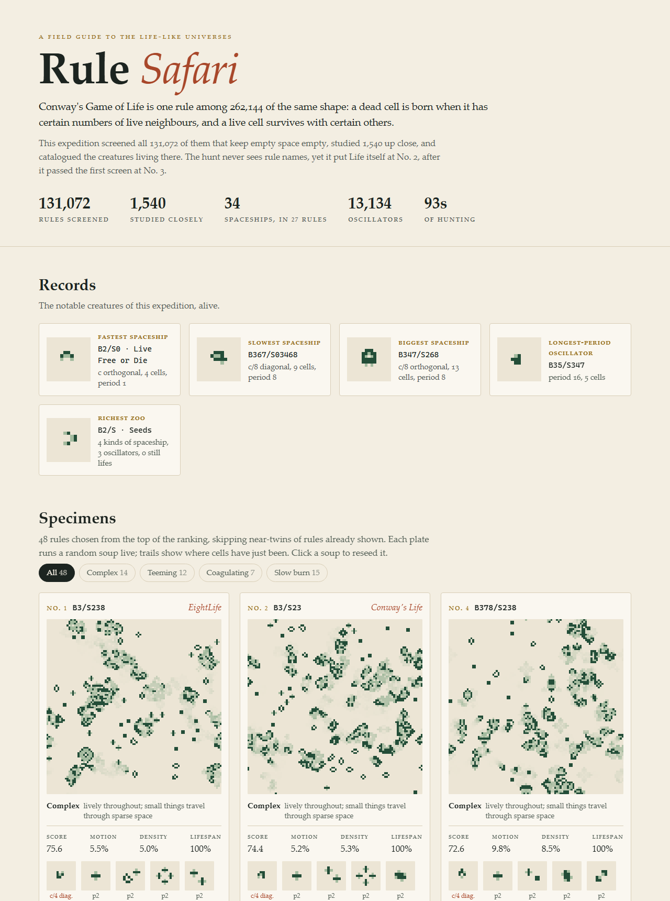

# Rule Safari

**Hunts through all 131,072 Life-like cellular automata for the interesting ones, and catalogues the creatures living in them.**

<picture>
  <source media="(prefers-color-scheme: dark)" srcset="docs/gallery-dark.png">
  
</picture>

Conway's Game of Life is one rule among 262,144 of the same shape. Written as **B3/S23**, it says: a dead cell is **b**orn with exactly 3 live neighbours, and a live cell **s**urvives with 2 or 3. Change the digits and you get another universe. Most of them are dull. They freeze, die out, or boil into static. A few are alive the way Life is, with gliders crossing quiet space and oscillators ticking in the debris.

Rule Safari screens every rule that keeps empty space empty (no B0), studies the most promising 1,500 up close, and writes a field guide. The guide is one self-contained HTML page where each chosen rule runs live next to the spaceships and oscillators the hunt caught in it.

The hunt never sees rule names. On the default seed it still ranks **Conway's Life No. 2** out of 131,072, just behind its close relative EightLife, and seven of its top ten are rules that already have names on LifeWiki.

## Quick start

You need a Rust toolchain, 1.87 or later.

```bash
cargo run --release -- hunt --quick
```

That runs a 4,096-rule sample in a few seconds. For the full hunt over every rule:

```bash
cargo run --release -- hunt
```

That takes about 90 seconds on 16 cores. Either way, open `safari/gallery.html` afterwards. The numbers for every studied rule are in `safari/results.json`.

Two smaller tools:

```bash
cargo run --release -- inspect B3/S23
```

```bash
cargo run --release -- watch B36/S23
```

`inspect` studies one rule and lists what lives in it. `watch` plays a soup in the terminal and needs one that understands ANSI colours, such as Windows Terminal or any Unix terminal. Rules can be written `B3/S23`, `b3s23` or in the classic survival/birth form `23/3`.

`inspect B3/S23` prints, trimmed:

```text
B3/S23 · Conway's Life
  temperament  complex: lively for all 600 generations, things travel through sparse space
  score        74.4   (quick screen: 67.7)
  soups        lifespan 100.0%  activity 3.5%  motion 5.2%  density 5.3%  structure 0.14  extinct 0.0%
  zoo          1 spaceship · 9 oscillators · 10 still lifes

  spaceship   c/4 diagonal       period 4     5 cells   seen 34×
  oscillator                     period 2     3 cells   seen 84×
  oscillator                     period 2     6 cells   seen 18×
  oscillator                     period 2    12 cells   seen 9×
  ...
  still life                                  4 cells   seen 155×
  still life                                  6 cells   seen 44×
  ...

   █▄    █      ▀▀▀       ▀▀▀     ▄▀ ▄   ▄▀▄
  ▀ ▀    ▀          █   █     █   ▀ ▄▀   ▀▄▀
                    ▀   ▀     ▀              █
                          ▀▀▀                ▀
```

The first two drawings are the glider and the blinker, rediscovered from random soup.

## What the default hunt found

Seed 1: 131,072 rules screened, 1,540 studied closely, 93 seconds on a 16-core laptop.

- **Life's family takes the top of the ranking.** Ten of the top 12 contain Life's B3/S23 core, and seven of them are named rules on LifeWiki: EightLife (No. 1), Conway's Life (No. 2), HoneyLife (No. 3), IronLife (No. 5), Pedestrian Life (No. 6), LowDeath (No. 7) and HighLife (No. 10).
- **They got there on merit.** All seven passed the cheap first screen inside the 1,500 that went on, from Conway's Life at No. 3 and EightLife at No. 21 to HighLife at No. 1,077. So did DryLife (No. 22 overall) and Day & Night (No. 34).
- **34 kinds of spaceship turned up across 27 rules**, along with 13,134 oscillator species.
- **The fastest spaceship moves at c**, one cell per generation. It has 4 cells and period 1, and lives in Seeds, Live Free or Die and a few other B2 rules.
- **The slow ones** include a c/8 diagonal ship in B367/S03468, a 13-cell c/8 orthogonal ship in B347/S268, and c/7 diagonal ships in B36/S245, B3/S245 and B38/S02458.

Results depend on the random soups, so another `--seed` reshuffles the order. With `--seed 2`, Pedestrian Life comes first and Life third, but 9 of the top 12 still carry Life's B3/S23 core.

## How it works

1. **Screen.** Every rule gets two random 40×40 soups for 160 generations, plus two tiny seeds dropped into empty space. The screen keeps each rule's better soup, so one unlucky run can't sink a good rule. The best 1,500 move on.
2. **Study.** The finalists, plus every named rule, get two 128×128 soups for 600 generations and 32 nurseries. A nursery is a small random seed in a quiet 64×64 field, where creatures can escape the crowd.
3. **Census.** The live cells are split into separate objects; cells within two of each other belong together, because at three apart they can't influence each other. Each object is replayed alone on an empty grid. If it comes back to its own shape within 16 generations, it is catalogued: a still life, an oscillator, or, if it came back somewhere else, a spaceship with a speed such as `c/4 diagonal`. The same creature in any rotation, reflection or phase is counted once.
4. **Score.** 55% is liveliness and 45% is the zoo, where spaceships count most and oscillators beyond period 2 count more than flickers.
5. **Pick.** The gallery shows 48 rules from the top of the ranking. Each pick maximises its score minus its resemblance to rules already shown (maximal marginal relevance over five behaviour features), so the page isn't 48 copies of the same texture. Near-twins are listed as "close relatives" on the plate that stands in for them.

### Liveliness: comparing against 12 generations ago

The first version of the scoring loved the wrong rules: big still blobs whose edges flicker forever. They never settle, and their large uniform regions compress beautifully, so they looked lively and structured.

The fix compares each soup with itself **12 generations earlier**. Twelve is a multiple of 1, 2, 3, 4, 6 and 12, so every oscillator with one of those periods lines up exactly and cancels out. What's left is change that *goes somewhere*: spaceships, growing debris, or noise.

Liveliness is 0 below 0.1% of cells moving (frozen or just flickering), and 1 between 0.5% and 10% (Life sits at about 5%). Above that it fades towards 0.1 by 35%, where soups are mostly noise. It is then multiplied by how long the soups stay unsettled, and discounted for crowded soups, because interesting things happen against a quiet background.

### Temperaments

Every studied rule gets one label, shown on its plate and usable as a filter:

| Temperament | What its soups do |
|---|---|
| complex | stay lively, with small things travelling through sparse space (Life) |
| teeming | stay dense, stirring everywhere at once |
| coagulating | stay lively, clumping into large blobs (Day & Night) |
| slow burn | stay busy for a while, then settle |
| simmering | never settle, but only flicker in place |
| chaotic | never settle, and look like noise (Seeds) |
| frozen | lock up almost at once |
| extinct | die out |

## Project layout

```text
src/
  rule.rs      B/S notation, the rule space, named rules
  sim.rs       toroidal grid stepping any rule, deterministic RNG
  census.rs    splitting soups into objects, classifying them, speed labels
  metrics.rs   Lempel-Ziv structure measure, cycle detector
  hunt.rs      screen, study, scoring and temperaments
  report.rs    results.json, gallery data, diversity picks, records
  watch.rs     terminal rendering with half-block characters
  main.rs      the CLI: hunt, inspect, watch
assets/
  gallery.html the field-guide template; the hunt embeds its data in it
tests/
  cli.rs       end-to-end tests of the binary
```

Every random number comes from a stream keyed by (seed, rule, soup number), so a hunt is reproducible no matter how the threads are scheduled. Run the tests with `cargo test --release`.

## Limits

- **Named rules are always studied,** so the famous-rules table is complete. The 52 names come from LifeWiki's list of Life-like rules, checked against its November 2025 archived copy. The gallery marks which of them made the first 1,500 on merit.
- **The census only sees small, fast creatures:** at most 16×16 cells, 64 live cells and period 16. Bigger or slower ships are missed. Day & Night is known to have spaceships, but none were caught.
- **Rules with B0 are left out.** They make empty space flash on and off. `inspect` accepts them but warns that its census can't be trusted.
- **The scores are a judgement call.** They encode one idea of "interesting": lively, sparse, and full of things that move. Other weightings would find other gems.

## License

MIT. See [LICENSE](LICENSE).
